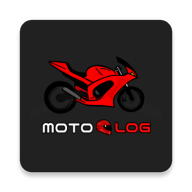

# Motolog

A diary of your biker's life, to keep track of your journey with your bike ✌🏻

## Features

- Save your bikes
- Save your gear
- Log everything about your bikes [distance, maintenance, mods and more!]
- Keep track of the distance you rode and the money you spent
- Record rides linked to your motorcycles, review routes and statistics, and confirm mileage updates
- Backup your data and photos

## Links

 - [Playstore Download](https://play.google.com/store/apps/details?id=com.gwynn7.motolog)
 - [@motologapp](https://www.instagram.com/motologapp)

## FAQ

#### How can i backup my data?

Use Export in Settings to create a single `.motolog` backup containing motorcycles, logs, gear, rides, available photos, and settings. Android's file picker lets you choose where to save it, including an existing cloud provider. Import accepts current archives, version 1 archives, and legacy single-database backups. Finish an active ride before importing or exporting.

#### Does the app store any personal data?

Your garage and recorded rides are stored on your device. Recording and route previews work offline. Optional Google maps need a connection; fuel search opens Google Maps after you tap it. MotoLog has no account or hosted storage backend.

## Feedback

If you have feedback, reach out to me at mattcheru03@gmail.com or [@motologapp](https://www.instagram.com/motologapp)

## License

[GNU GPLv3](https://choosealicense.com/licenses/gpl-3.0/)

## Logo

## Development and release

Debug builds install separately as MotoLog Dev.
